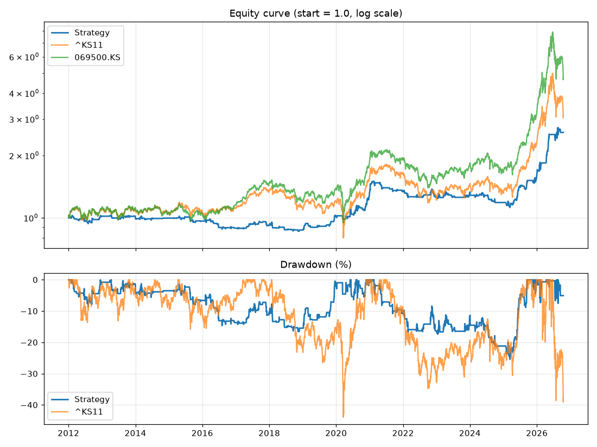

# 백테스트 결과: A_KODEX200

- 실행 시각: 2026-10-16 16:11 (KST)
- 기간: 2012-01-02 ~ 2026-10-16
- 매매 종목: KODEX 200 (069500.KS)
- 비교 기준(벤치마크): 시작일에 같은 금액으로 사서 끝까지 보유 / 목표 판정 기준은 **코스피 지수**

## 목표 달성 체크

목표: 같은 기간 코스피 지수 수익률을 소폭이라도 넘으면서, 최대 낙폭은 더 작게

- ❌ **수익률**: 연평균 6.6% vs 코스피 지수 8.0% (차이 -1.3%p)
- ✅ **낙폭**: 최대 낙폭 -25.4% vs 코스피 지수 -43.9% (전략이 18.5%p 더 작음)
- 참고: 코스피 지수가 오른 11개 연도 중 전략이 앞선 해 2개, 내린 4개 연도 중 전략이 덜 잃은 해 3개 (첫 해와 마지막 해는 일부 기간만 포함)
- 종합: **한 가지만 충족했습니다**

## 핵심 성과

| 항목 | 이 전략 | 코스피 지수 보유(벤치마크) | KODEX 200 보유 |
|---|---|---|---|
| 누적 수익률(%) | 158.3 | 210.3 | 373.5 |
| 연평균 수익률 CAGR(%) | 6.6 | 8.0 | 11.1 |
| 최대 낙폭 MDD(%) | -25.4 | -43.9 | -41.2 |
| 낙폭 대비 수익 (CAGR ÷ 최대낙폭) | 0.26 | 0.18 | 0.27 |
| 최대 낙폭 구간 | 2021-02-16 → 2025-03-13 | 2018-01-29 → 2020-03-19 | 2026-06-22 → 2026-10-15 |

| 전략 매매 정보 | 값 |
|---|---|
| 거래 횟수 | 220 |
| 승률(%) | 50.5 |
| 거래당 평균 수익률(%) | 0.47 |
| 평균 보유일 | 6.8 |
| 보유 중이었던 날 비율(%) | 33.4 |



## 연도별 수익률(%)

| 연도 | 이 전략 | 코스피 지수 | KODEX 200 | 전략 - 코스피 지수 (%p) |
|---|---|---|---|---|
| 2012 | 1.8 | 9.3 | 11.0 | -7.6 |
| 2013 | 0.1 | 0.7 | 1.1 | -0.7 |
| 2014 | -2.2 | -4.8 | -6.6 | +2.5 |
| 2015 | -3.2 | 2.4 | -0.1 | -5.6 |
| 2016 | -7.6 | 3.3 | 10.2 | -10.9 |
| 2017 | 3.6 | 21.8 | 27.1 | -18.1 |
| 2018 | -5.5 | -17.3 | -17.3 | +11.8 |
| 2019 | 17.2 | 7.7 | 14.4 | +9.5 |
| 2020 | 29.1 | 30.8 | 35.5 | -1.7 |
| 2021 | 1.7 | 3.6 | 3.0 | -2.0 |
| 2022 | -6.3 | -24.9 | -24.1 | +18.6 |
| 2023 | 5.3 | 18.7 | 24.6 | -13.4 |
| 2024 | -10.5 | -9.6 | -9.4 | -0.9 |
| 2025 | 35.0 | 75.6 | 94.2 | -40.6 |
| 2026 | 61.5 | 34.5 | 46.8 | +27.0 |

## 최근 거래 30건

| 진입일 | 진입가 | 청산일 | 청산가 | 사유 | 수익률(%) | 보유일 |
|---|---|---|---|---|---|---|
| 2024-08-16 | 35645.36 | 2024-09-03 | 35053.86 | 신호 | -1.69 | 18 |
| 2024-09-20 | 33680.92 | 2024-10-04 | 33130.05 | 신호 | -1.67 | 14 |
| 2025-01-24 | 32870.0 | 2025-02-03 | 31854.18 | 신호 | -3.12 | 10 |
| 2025-02-13 | 33059.97 | 2025-03-04 | 32710.63 | 신호 | -1.09 | 19 |
| 2025-03-07 | 33094.08 | 2025-03-12 | 33061.0 | 신호 | -0.13 | 5 |
| 2025-03-13 | 33668.86 | 2025-03-24 | 34749.57 | 신호 | 3.18 | 11 |
| 2025-04-07 | 31135.9 | 2025-04-08 | 31289.7 | 신호 | 0.46 | 1 |
| 2025-04-16 | 32358.54 | 2025-05-07 | 33835.8 | 신호 | 4.53 | 21 |
| 2025-05-08 | 33849.92 | 2025-05-09 | 33840.72 | 신호 | -0.06 | 1 |
| 2025-05-21 | 34535.6 | 2025-05-26 | 34225.11 | 신호 | -0.93 | 5 |
| 2025-05-27 | 34624.38 | 2025-05-30 | 35831.64 | 신호 | 3.46 | 3 |
| 2025-06-02 | 35556.71 | 2025-06-17 | 39148.2 | 신호 | 10.07 | 15 |
| 2025-06-18 | 38876.6 | 2025-06-19 | 39695.21 | 신호 | 2.08 | 1 |
| 2025-06-27 | 41135.89 | 2025-07-09 | 41730.48 | 신호 | 1.42 | 12 |
| 2025-07-28 | 43123.86 | 2025-07-29 | 42730.87 | 신호 | -0.94 | 1 |
| 2025-08-13 | 43322.49 | 2025-08-21 | 42156.02 | 신호 | -2.72 | 8 |
| 2025-09-01 | 42406.21 | 2025-09-04 | 42670.6 | 신호 | 0.59 | 3 |
| 2025-09-09 | 43357.17 | 2025-09-22 | 47267.19 | 신호 | 8.99 | 13 |
| 2025-11-18 | 56580.6 | 2025-11-19 | 55477.49 | 신호 | -1.98 | 1 |
| 2025-12-01 | 55816.0 | 2025-12-23 | 58245.17 | 신호 | 4.32 | 22 |
| 2025-12-24 | 58507.01 | 2026-01-06 | 64326.11 | 신호 | 9.91 | 13 |
| 2026-01-07 | 66550.23 | 2026-01-08 | 65739.71 | 신호 | -1.25 | 1 |
| 2026-01-27 | 71564.83 | 2026-02-06 | 73137.47 | 신호 | 2.17 | 10 |
| 2026-02-11 | 77758.35 | 2026-02-19 | 83326.07 | 신호 | 7.13 | 8 |
| 2026-04-13 | 85949.2 | 2026-04-24 | 98008.18 | 신호 | 14.0 | 11 |
| 2026-04-29 | 99596.05 | 2026-05-06 | 111176.75 | 신호 | 11.59 | 7 |
| 2026-05-07 | 115127.05 | 2026-05-15 | 124218.52 | 신호 | 7.86 | 8 |
| 2026-07-16 | 110948.51 | 2026-07-23 | 110937.36 | 신호 | -0.04 | 7 |
| 2026-08-03 | 102030.99 | 2026-09-01 | 106576.69 | 신호 | 4.42 | 29 |
| 2026-09-11 | 107773.86 | 2026-09-14 | 105692.13 | 신호 | -1.96 | 3 |

## 가정과 한계 (꼭 읽어주세요)

- 신호는 외환 **일봉 종가** 기준이고, 매매는 **다음 코스피 거래일**에 체결된다고 가정했습니다(미래 데이터 엿보기 방지).
- 실제 알림은 15분마다 장중 가격으로 판단하므로 결과가 이 백테스트와 다를 수 있습니다.
- 벤치마크는 시작일 종가에 같은 금액을 넣어 끝까지 보유한 것으로 계산했습니다. 코스피 지수는 배당이 빠진 가격 지수이고, ETF는 배당이 반영된 조정주가입니다.
- 전략은 시장 밖에 있는 동안 현금 이자를 0%로 계산했습니다.
- 전액 매수이며 소수점 수량도 허용합니다. 호가 단위, 미체결, 시초가 급변은 반영하지 않았습니다.
- 같은 날 손절과 익절이 모두 가능한 경우 손절이 먼저라고 보수적으로 가정했습니다.
- 과거 결과가 미래를 보장하지 않습니다. 조건을 여러 번 바꿔가며 가장 좋은 값만 고르면 과거에만 잘 맞는 설정(과최적화)이 되기 쉽습니다. 연도별 결과가 고르게 좋은지 함께 보세요.

## 이번에 사용한 설정

```toml
# ============================================================
#  백테스트 설정 파일
#  숫자, true/false, 따옴표 안의 글자만 바꾸세요. (# 으로 시작하는 줄은 설명입니다)
#  바꾼 뒤 저장(Commit)하고, GitHub의 Actions 탭에서 backtest 를 실행하면 됩니다.
# ============================================================

# 이번 실행의 이름 (결과 폴더 이름과 비교표에 표시됩니다. 조건을 바꿀 때마다 다르게 적어두세요)
label = "A_KODEX200"

# 백테스트 기간. end_date 를 비워두면 오늘까지입니다.
start_date = "2012-01-01"
end_date = ""

[market]
trade_ticker = "069500.KS"                         # 매매할 종목 (KODEX 레버리지)
fx_pairs = ["EURUSD=X", "GBPUSD=X", "AUDUSD=X"]    # 점수를 매길 외환

[benchmark]
# 비교 기준: 시작일에 같은 금액으로 사서 끝까지 보유했다고 계산합니다.
# 첫 번째 종목이 보고서의 '목표 달성 체크' 기준입니다. (^KS11 = 코스피 지수, 069500.KS = KODEX 200)
tickers = ["^KS11", "069500.KS"]

[signal]
ma_short = 5            # 이평선 (짧은 것)
ma_mid = 10             # 현재가와 비교하는 이평선
ma_long = 20            # 이평선 (긴 것)
buy_threshold = 2       # 합산 점수가 이 값 이상이면 '상승'
sell_threshold = -2     # 합산 점수가 이 값 이하이면 '하락'
confirm_days = 1        # 같은 신호가 며칠 연속 유지돼야 인정할지 (1 = 바로 인정)

[entry]
execution = "next_open"             # 체결 시점: "next_open"(다음 거래일 시가) 또는 "next_close"(다음 거래일 종가)
reentry_after_take_profit = false   # 익절 후 신호가 계속 '상승'이면 바로 다시 살지 (true/false)

[exit]
take_profit_pct = 0.0     # 수익률이 이 % 에 도달하면 전량 매도 (0 = 사용 안 함)
stop_loss_pct = 0.0       # 손실이 이 % 에 도달하면 전량 매도 (0 = 사용 안 함)
exit_on_neutral = true    # '중립' 신호가 되면 전량 매도
exit_on_down = true       # '하락' 신호가 되면 전량 매도

[cost]
fee_pct_per_side = 0.015       # 매수/매도 각각의 수수료 (%)
slippage_pct_per_side = 0.05   # 매수/매도 각각의 체결 오차 (%)
```
