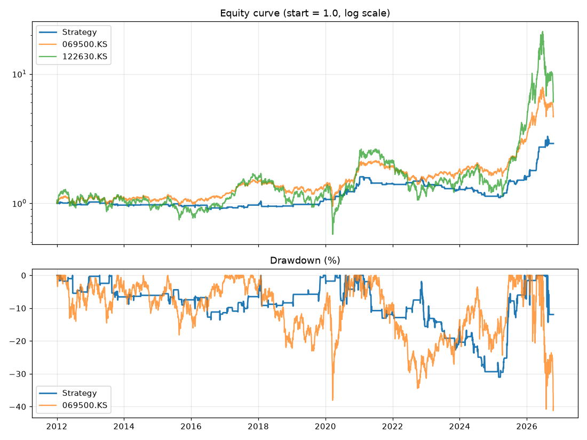

# 백테스트 결과: A_점수3_전체

- 실행 시각: 2026-10-17 18:59 (KST)
- 기간: 2012-01-02 ~ 2026-10-16
- 매매 종목: KODEX 레버리지 (122630.KS)
- 투자 비중: 매수할 때 현금의 75%만 투자, 나머지는 현금
- 비교 기준(벤치마크): 시작일에 같은 금액으로 사서 끝까지 보유 / 목표 판정 기준은 **KODEX 200**

## 목표 달성 체크

목표: 같은 기간 KODEX 200 수익률을 소폭이라도 넘으면서, 최대 낙폭은 더 작게

- ❌ **수익률**: 연평균 7.5% vs KODEX 200 11.1% (차이 -3.6%p)
- ✅ **낙폭**: 최대 낙폭 -31.0% vs KODEX 200 -41.2% (전략이 10.2%p 더 작음)
- 참고: KODEX 200가 오른 10개 연도 중 전략이 앞선 해 1개, 내린 5개 연도 중 전략이 덜 잃은 해 3개 (첫 해와 마지막 해는 일부 기간만 포함)
- 종합: **한 가지만 충족했습니다**

## 핵심 성과

| 항목 | 이 전략 | KODEX 200 보유(벤치마크) | KODEX 레버리지 보유 |
|---|---|---|---|
| 누적 수익률(%) | 189.7 | 373.5 | 527.6 |
| 연평균 수익률 CAGR(%) | 7.5 | 11.1 | 13.2 |
| 최대 낙폭 MDD(%) | -31.0 | -41.2 | -71.6 |
| 낙폭 대비 수익 (CAGR ÷ 최대낙폭) | 0.24 | 0.27 | 0.18 |
| 최대 낙폭 구간 | 2021-02-16 → 2025-02-28 | 2026-06-22 → 2026-10-15 | 2026-06-22 → 2026-10-15 |

| 전략 매매 정보 | 값 |
|---|---|
| 거래 횟수 | 145 |
| 승률(%) | 60.0 |
| 거래당 평균 수익률(%) | 0.82 |
| 평균 보유일 | 5.7 |
| 보유 중이었던 날 비율(%) | 19.3 |



## 최대 낙폭 구간의 거래 요약 (2021-02-16 → 2025-02-28)

| 항목 | 값 |
|---|---|
| 청산된 거래 수 | 46 (이익 22 / 손실 24) |
| 승률(%) | 47.8 |
| 이익 거래 평균(%) | 1.32 |
| 손실 거래 평균(%) | -2.68 |
| 거래 손익 복리 합계(%) | -30.86 |
| 최대 연속 손실 횟수 | 4 |
| 이 구간에서 시장에 들어가 있던 날 비율(%) | 22.3 |

가장 크게 잃은 거래 5건

| 진입일 | 청산일 | 사유 | 수익률(%) | 보유일 |
|---|---|---|---|---|
| 2022-12-02 | 2022-12-07 | 신호 | -5.78 | 5 |
| 2021-05-11 | 2021-05-14 | 신호 | -5.06 | 3 |
| 2022-11-14 | 2022-11-23 | 신호 | -4.68 | 9 |
| 2024-05-16 | 2024-05-24 | 신호 | -4.3 | 8 |
| 2021-04-21 | 2021-05-04 | 신호 | -4.11 | 13 |

## 연도별 수익률(%)

| 연도 | 이 전략 | KODEX 200 | KODEX 레버리지 | 전략 - KODEX 200 (%p) |
|---|---|---|---|---|
| 2012 | 2.2 | 11.0 | 15.6 | -8.9 |
| 2013 | -5.4 | 1.1 | -4.2 | -6.5 |
| 2014 | 0.5 | -6.6 | -17.2 | +7.1 |
| 2015 | -1.4 | -0.1 | -4.1 | -1.3 |
| 2016 | -4.2 | 10.2 | 15.1 | -14.4 |
| 2017 | 5.5 | 27.1 | 55.3 | -21.6 |
| 2018 | -1.6 | -17.3 | -35.2 | +15.7 |
| 2019 | 14.3 | 14.4 | 26.0 | -0.2 |
| 2020 | 28.4 | 35.5 | 63.3 | -7.1 |
| 2021 | 0.9 | 3.0 | 1.3 | -2.1 |
| 2022 | -4.0 | -24.1 | -46.4 | +20.1 |
| 2023 | -1.2 | 24.6 | 46.1 | -25.8 |
| 2024 | -15.3 | -9.4 | -25.6 | -5.9 |
| 2025 | 41.7 | 94.2 | 243.4 | -52.5 |
| 2026 | 80.6 | 46.8 | 47.4 | +33.7 |

## 최근 거래 30건

| 진입일 | 진입가 | 청산일 | 청산가 | 사유 | 수익률(%) | 보유일 |
|---|---|---|---|---|---|---|
| 2024-05-07 | 19564.78 | 2024-05-09 | 19935.03 | 신호 | 1.4 | 2 |
| 2024-05-16 | 20350.17 | 2024-05-24 | 19190.4 | 신호 | -4.3 | 8 |
| 2024-05-29 | 19489.74 | 2024-05-30 | 18695.65 | 신호 | -3.08 | 1 |
| 2024-06-04 | 18734.36 | 2024-06-11 | 19285.35 | 신호 | 2.18 | 7 |
| 2024-07-09 | 22316.15 | 2024-07-18 | 21139.43 | 신호 | -3.98 | 9 |
| 2024-08-20 | 18939.46 | 2024-09-02 | 18190.9 | 신호 | -2.99 | 13 |
| 2024-09-20 | 16698.34 | 2024-10-02 | 16036.98 | 신호 | -2.99 | 12 |
| 2025-02-18 | 16153.07 | 2025-02-26 | 16321.84 | 신호 | 0.76 | 8 |
| 2025-02-27 | 16593.29 | 2025-02-28 | 15912.04 | 신호 | -3.1 | 1 |
| 2025-03-19 | 16528.26 | 2025-03-24 | 17011.49 | 신호 | 2.17 | 5 |
| 2025-04-17 | 14282.14 | 2025-04-29 | 15432.28 | 신호 | 6.02 | 12 |
| 2025-04-30 | 15532.76 | 2025-05-02 | 15557.22 | 신호 | 0.1 | 2 |
| 2025-05-27 | 16548.27 | 2025-05-30 | 17696.15 | 신호 | 5.18 | 3 |
| 2025-06-02 | 17383.69 | 2025-06-12 | 20459.76 | 신호 | 13.24 | 10 |
| 2025-06-13 | 20720.36 | 2025-06-17 | 21064.46 | 신호 | 1.22 | 4 |
| 2025-06-18 | 20730.36 | 2025-06-19 | 21669.16 | 신호 | 3.37 | 1 |
| 2025-07-01 | 23411.7 | 2025-07-08 | 23088.45 | 신호 | -1.06 | 7 |
| 2025-08-14 | 25617.8 | 2025-08-18 | 25142.42 | 신호 | -1.41 | 4 |
| 2025-08-19 | 24807.4 | 2025-08-20 | 23813.09 | 신호 | -3.03 | 1 |
| 2025-09-01 | 24327.16 | 2025-09-04 | 24687.65 | 신호 | 1.09 | 3 |
| 2025-09-12 | 28114.05 | 2025-09-22 | 30179.9 | 신호 | 5.49 | 10 |
| 2025-12-02 | 40530.25 | 2025-12-18 | 41299.34 | 신호 | 1.4 | 16 |
| 2025-12-24 | 44787.38 | 2026-01-02 | 47976.0 | 신호 | 5.32 | 9 |
| 2026-01-27 | 66533.25 | 2026-02-04 | 76446.76 | 신호 | 11.15 | 8 |
| 2026-04-13 | 86248.1 | 2026-04-23 | 111744.1 | 신호 | 22.14 | 10 |
| 2026-05-04 | 120920.43 | 2026-05-06 | 144082.92 | 신호 | 14.34 | 2 |
| 2026-05-13 | 153906.91 | 2026-05-14 | 171879.02 | 신호 | 8.73 | 1 |
| 2026-07-20 | 109919.93 | 2026-07-22 | 129145.4 | 신호 | 13.09 | 2 |
| 2026-08-05 | 104052.0 | 2026-08-14 | 113933.0 | 신호 | 7.1 | 9 |
| 2026-08-18 | 119559.75 | 2026-08-31 | 100559.7 | 신호 | -11.94 | 13 |

## 가정과 한계 (꼭 읽어주세요)

- 신호는 외환 **일봉 종가** 기준이고, 매매는 **다음 코스피 거래일**에 체결된다고 가정했습니다(미래 데이터 엿보기 방지).
- 실제 알림은 15분마다 장중 가격으로 판단하므로 결과가 이 백테스트와 다를 수 있습니다.
- 벤치마크는 시작일 종가에 같은 금액을 넣어 끝까지 보유한 것으로 계산했습니다. ETF는 배당이 반영된 조정주가입니다(코스피 지수 ^KS11은 배당 없는 가격 지수).
- 투자 비중이 100% 미만이면 거래별 수익률은 투자금이 아닌 전체 자산 대비로 표시됩니다.
- 전략은 시장 밖에 있는 동안 현금 이자를 0%로 계산했습니다.
- 소수점 수량도 허용합니다(실제로는 정수 주식만 가능). 호가 단위, 미체결, 시초가 급변은 반영하지 않았습니다.
- 같은 날 손절과 익절이 모두 가능한 경우 손절이 먼저라고 보수적으로 가정했습니다.
- 과거 결과가 미래를 보장하지 않습니다. 조건을 여러 번 바꿔가며 가장 좋은 값만 고르면 과거에만 잘 맞는 설정(과최적화)이 되기 쉽습니다. 연도별 결과가 고르게 좋은지 함께 보세요.

## 이번에 사용한 설정

```toml
# ============================================================
#  백테스트 설정 파일
#  숫자, true/false, 따옴표 안의 글자만 바꾸세요. (# 으로 시작하는 줄은 설명입니다)
#  바꾼 뒤 저장(Commit)하고, GitHub의 Actions 탭에서 backtest 를 실행하면 됩니다.
# ============================================================

# 이번 실행의 이름 (결과 폴더 이름과 비교표에 표시됩니다. 조건을 바꿀 때마다 다르게 적어두세요)
label = "A_점수3_전체"

# 백테스트 기간. end_date 는 그 날짜 '전날'까지 계산합니다. (2026-10-17 = 10월 16일까지)
# 실험끼리 비교할 때는 같은 값으로 고정하세요. 비워두면 실행하는 날까지입니다.
start_date = "2012-01-01"
end_date = "2026-10-17"

[market]
trade_ticker = "122630.KS"                         # 매매할 종목 (122630.KS = KODEX 레버리지, 069500.KS = KODEX 200)
fx_pairs = ["EURUSD=X", "GBPUSD=X", "AUDUSD=X"]    # 점수를 매길 외환

[benchmark]
# 비교 기준: 시작일에 같은 금액으로 사서 끝까지 보유했다고 계산합니다.
# 첫 번째 종목이 보고서의 '목표 달성 체크' 기준입니다. (069500.KS = KODEX 200, 코스피 지수를 다시 넣으려면 "^KS11" 추가)
tickers = ["069500.KS"]

[signal]
ma_short = 5            # 이평선 (짧은 것)
ma_mid = 10             # 현재가와 비교하는 이평선
ma_long = 20            # 이평선 (긴 것)
buy_threshold = 3       # 합산 점수가 이 값 이상이면 '상승'
sell_threshold = -2     # 합산 점수가 이 값 이하이면 '하락'
confirm_days = 1        # 같은 신호가 며칠 연속 유지돼야 인정할지 (1 = 바로 인정)

[entry]
execution = "next_open"             # 체결 시점: "next_open"(다음 거래일 시가) 또는 "next_close"(다음 거래일 종가)
reentry_after_take_profit = false   # 익절 후 신호가 계속 '상승'이면 바로 다시 살지 (true/false)
invest_fraction = 0.75               # 매수할 때 현금의 몇 %를 투자할지 (1.0 = 100%, 0.5 = 50%, 나머지는 현금)

[exit]
take_profit_pct = 0.0     # 수익률이 이 % 에 도달하면 전량 매도 (0 = 사용 안 함)
stop_loss_pct = 0.0       # 손실이 이 % 에 도달하면 전량 매도 (0 = 사용 안 함)
exit_on_neutral = true    # '중립' 신호가 되면 전량 매도
exit_on_down = true       # '하락' 신호가 되면 전량 매도

[cost]
fee_pct_per_side = 0.015       # 매수/매도 각각의 수수료 (%)
slippage_pct_per_side = 0.05   # 매수/매도 각각의 체결 오차 (%)
```
