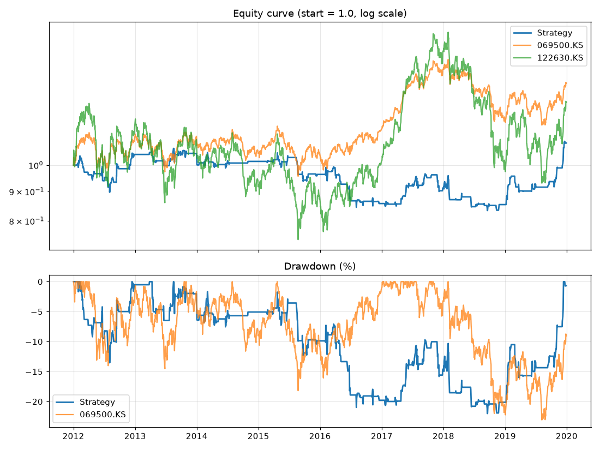

# 백테스트 결과: 비중75_전반

- 실행 시각: 2026-10-17 13:30 (KST)
- 기간: 2012-01-02 ~ 2019-12-30
- 매매 종목: KODEX 레버리지 (122630.KS)
- 투자 비중: 매수할 때 현금의 75%만 투자, 나머지는 현금
- 비교 기준(벤치마크): 시작일에 같은 금액으로 사서 끝까지 보유 / 목표 판정 기준은 **KODEX 200**

## 목표 달성 체크

목표: 같은 기간 KODEX 200 수익률을 소폭이라도 넘으면서, 최대 낙폭은 더 작게

- ❌ **수익률**: 연평균 1.1% vs KODEX 200 4.2% (차이 -3.1%p)
- ✅ **낙폭**: 최대 낙폭 -22.0% vs KODEX 200 -23.1% (전략이 1.1%p 더 작음)
- 참고: KODEX 200가 오른 5개 연도 중 전략이 앞선 해 1개, 내린 3개 연도 중 전략이 덜 잃은 해 2개 (첫 해와 마지막 해는 일부 기간만 포함)
- 종합: **한 가지만 충족했습니다**

## 핵심 성과

| 항목 | 이 전략 | KODEX 200 보유(벤치마크) | KODEX 레버리지 보유 |
|---|---|---|---|
| 누적 수익률(%) | 9.2 | 38.8 | 28.6 |
| 연평균 수익률 CAGR(%) | 1.1 | 4.2 | 3.2 |
| 최대 낙폭 MDD(%) | -22.0 | -23.1 | -45.3 |
| 낙폭 대비 수익 (CAGR ÷ 최대낙폭) | 0.05 | 0.18 | 0.07 |
| 최대 낙폭 구간 | 2013-08-16 → 2018-09-18 | 2018-01-29 → 2019-08-07 | 2018-01-29 → 2019-08-07 |

| 전략 매매 정보 | 값 |
|---|---|
| 거래 횟수 | 116 |
| 승률(%) | 52.6 |
| 거래당 평균 수익률(%) | 0.10 |
| 평균 보유일 | 5.9 |
| 보유 중이었던 날 비율(%) | 29.0 |



## 최대 낙폭 구간의 거래 요약 (2013-08-16 → 2018-09-18)

| 항목 | 값 |
|---|---|
| 청산된 거래 수 | 70 (이익 33 / 손실 36) |
| 승률(%) | 47.1 |
| 이익 거래 평균(%) | 1.10 |
| 손실 거래 평균(%) | -1.63 |
| 거래 손익 복리 합계(%) | -21.09 |
| 최대 연속 손실 횟수 | 6 |
| 이 구간에서 시장에 들어가 있던 날 비율(%) | 28.9 |

가장 크게 잃은 거래 5건

| 진입일 | 청산일 | 사유 | 수익률(%) | 보유일 |
|---|---|---|---|---|
| 2018-01-15 | 2018-02-06 | 신호 | -5.3 | 22 |
| 2016-06-21 | 2016-06-28 | 신호 | -4.7 | 7 |
| 2014-01-02 | 2014-01-03 | 신호 | -4.48 | 1 |
| 2017-11-27 | 2017-12-01 | 신호 | -4.31 | 4 |
| 2018-06-12 | 2018-06-18 | 신호 | -3.85 | 6 |

## 연도별 수익률(%)

| 연도 | 이 전략 | KODEX 200 | KODEX 레버리지 | 전략 - KODEX 200 (%p) |
|---|---|---|---|---|
| 2012 | 4.4 | 11.0 | 15.6 | -6.7 |
| 2013 | 0.4 | 1.1 | -4.2 | -0.7 |
| 2014 | -3.1 | -6.6 | -17.2 | +3.5 |
| 2015 | -5.1 | -0.1 | -4.1 | -4.9 |
| 2016 | -11.0 | 10.2 | 15.1 | -21.2 |
| 2017 | 6.4 | 27.1 | 55.3 | -20.7 |
| 2018 | -6.4 | -17.3 | -35.2 | +10.9 |
| 2019 | 27.9 | 14.4 | 26.0 | +13.5 |

## 최근 거래 30건

| 진입일 | 진입가 | 청산일 | 청산가 | 사유 | 수익률(%) | 보유일 |
|---|---|---|---|---|---|---|
| 2017-11-27 | 18604.3 | 2017-12-01 | 17541.23 | 신호 | -4.31 | 4 |
| 2017-12-06 | 17898.94 | 2017-12-07 | 17436.28 | 신호 | -1.96 | 1 |
| 2017-12-27 | 16968.48 | 2017-12-28 | 17216.39 | 신호 | 1.07 | 1 |
| 2018-01-02 | 17738.86 | 2018-01-11 | 17941.03 | 신호 | 0.83 | 9 |
| 2018-01-15 | 18069.03 | 2018-02-06 | 16796.6 | 신호 | -5.3 | 22 |
| 2018-03-15 | 17248.62 | 2018-03-19 | 17241.38 | 신호 | -0.05 | 4 |
| 2018-04-13 | 16418.2 | 2018-04-23 | 16681.66 | 신호 | 1.18 | 10 |
| 2018-06-12 | 16678.34 | 2018-06-18 | 15827.08 | 신호 | -3.85 | 6 |
| 2018-07-11 | 14287.14 | 2018-07-13 | 14462.77 | 신호 | 0.9 | 2 |
| 2018-07-17 | 14632.31 | 2018-07-19 | 14632.68 | 신호 | -0.02 | 2 |
| 2018-07-26 | 14552.27 | 2018-07-30 | 14587.7 | 신호 | 0.16 | 4 |
| 2018-08-29 | 14577.28 | 2018-08-31 | 14472.76 | 신호 | -0.56 | 2 |
| 2018-09-17 | 14462.23 | 2018-09-18 | 14082.96 | 신호 | -1.99 | 1 |
| 2018-09-20 | 14532.26 | 2018-10-01 | 14932.53 | 신호 | 2.04 | 11 |
| 2018-11-09 | 12086.04 | 2018-11-12 | 11784.11 | 신호 | -1.9 | 3 |
| 2018-11-26 | 11605.8 | 2018-11-27 | 11964.02 | 신호 | 2.29 | 1 |
| 2019-01-09 | 11375.68 | 2019-01-21 | 12643.68 | 신호 | 8.33 | 12 |
| 2019-01-29 | 13146.57 | 2019-02-07 | 13748.12 | 신호 | 3.41 | 9 |
| 2019-02-28 | 13811.9 | 2019-03-06 | 13038.48 | 신호 | -4.22 | 6 |
| 2019-03-21 | 13061.53 | 2019-03-26 | 12793.6 | 신호 | -1.56 | 5 |
| 2019-04-17 | 14012.0 | 2019-04-18 | 14003.0 | 신호 | -0.07 | 1 |
| 2019-06-07 | 11805.9 | 2019-06-17 | 11939.03 | 신호 | 0.82 | 10 |
| 2019-06-26 | 12396.2 | 2019-07-03 | 12523.74 | 신호 | 0.75 | 7 |
| 2019-09-11 | 11905.95 | 2019-09-18 | 12093.95 | 신호 | 1.16 | 7 |
| 2019-09-19 | 12186.09 | 2019-09-20 | 12333.83 | 신호 | 0.89 | 1 |
| 2019-09-23 | 12441.22 | 2019-09-24 | 12473.76 | 신호 | 0.17 | 1 |
| 2019-10-16 | 12501.25 | 2019-10-29 | 12733.63 | 신호 | 1.37 | 13 |
| 2019-11-01 | 12476.23 | 2019-11-07 | 13178.41 | 신호 | 4.2 | 6 |
| 2019-12-06 | 12311.15 | 2019-12-19 | 14157.92 | 신호 | 11.22 | 13 |
| 2019-12-23 | 14262.13 | 2019-12-24 | 14137.93 | 신호 | -0.68 | 1 |

## 가정과 한계 (꼭 읽어주세요)

- 신호는 외환 **일봉 종가** 기준이고, 매매는 **다음 코스피 거래일**에 체결된다고 가정했습니다(미래 데이터 엿보기 방지).
- 실제 알림은 15분마다 장중 가격으로 판단하므로 결과가 이 백테스트와 다를 수 있습니다.
- 벤치마크는 시작일 종가에 같은 금액을 넣어 끝까지 보유한 것으로 계산했습니다. ETF는 배당이 반영된 조정주가입니다(코스피 지수 ^KS11은 배당 없는 가격 지수).
- 투자 비중이 100% 미만이면 거래별 수익률은 투자금이 아닌 전체 자산 대비로 표시됩니다.
- 전략은 시장 밖에 있는 동안 현금 이자를 0%로 계산했습니다.
- 소수점 수량도 허용합니다(실제로는 정수 주식만 가능). 호가 단위, 미체결, 시초가 급변은 반영하지 않았습니다.
- 같은 날 손절과 익절이 모두 가능한 경우 손절이 먼저라고 보수적으로 가정했습니다.
- 과거 결과가 미래를 보장하지 않습니다. 조건을 여러 번 바꿔가며 가장 좋은 값만 고르면 과거에만 잘 맞는 설정(과최적화)이 되기 쉽습니다. 연도별 결과가 고르게 좋은지 함께 보세요.

## 이번에 사용한 설정

```toml
# ============================================================
#  백테스트 설정 파일
#  숫자, true/false, 따옴표 안의 글자만 바꾸세요. (# 으로 시작하는 줄은 설명입니다)
#  바꾼 뒤 저장(Commit)하고, GitHub의 Actions 탭에서 backtest 를 실행하면 됩니다.
# ============================================================

# 이번 실행의 이름 (결과 폴더 이름과 비교표에 표시됩니다. 조건을 바꿀 때마다 다르게 적어두세요)
label = "비중75_전반"

# 백테스트 기간. end_date 는 그 날짜 '전날'까지 계산합니다. (2026-10-17 = 10월 16일까지)
# 실험끼리 비교할 때는 같은 값으로 고정하세요. 비워두면 실행하는 날까지입니다.
start_date = "2012-01-01"
end_date = "2020-01-01"

[market]
trade_ticker = "122630.KS"                         # 매매할 종목 (122630.KS = KODEX 레버리지, 069500.KS = KODEX 200)
fx_pairs = ["EURUSD=X", "GBPUSD=X", "AUDUSD=X"]    # 점수를 매길 외환

[benchmark]
# 비교 기준: 시작일에 같은 금액으로 사서 끝까지 보유했다고 계산합니다.
# 첫 번째 종목이 보고서의 '목표 달성 체크' 기준입니다. (069500.KS = KODEX 200, 코스피 지수를 다시 넣으려면 "^KS11" 추가)
tickers = ["069500.KS"]

[signal]
ma_short = 5            # 이평선 (짧은 것)
ma_mid = 10             # 현재가와 비교하는 이평선
ma_long = 20            # 이평선 (긴 것)
buy_threshold = 2       # 합산 점수가 이 값 이상이면 '상승'
sell_threshold = -2     # 합산 점수가 이 값 이하이면 '하락'
confirm_days = 1        # 같은 신호가 며칠 연속 유지돼야 인정할지 (1 = 바로 인정)

[entry]
execution = "next_open"             # 체결 시점: "next_open"(다음 거래일 시가) 또는 "next_close"(다음 거래일 종가)
reentry_after_take_profit = false   # 익절 후 신호가 계속 '상승'이면 바로 다시 살지 (true/false)
invest_fraction = 0.75               # 매수할 때 현금의 몇 %를 투자할지 (1.0 = 100%, 0.5 = 50%, 나머지는 현금)

[exit]
take_profit_pct = 0.0     # 수익률이 이 % 에 도달하면 전량 매도 (0 = 사용 안 함)
stop_loss_pct = 0.0       # 손실이 이 % 에 도달하면 전량 매도 (0 = 사용 안 함)
exit_on_neutral = true    # '중립' 신호가 되면 전량 매도
exit_on_down = true       # '하락' 신호가 되면 전량 매도

[cost]
fee_pct_per_side = 0.015       # 매수/매도 각각의 수수료 (%)
slippage_pct_per_side = 0.05   # 매수/매도 각각의 체결 오차 (%)
```
