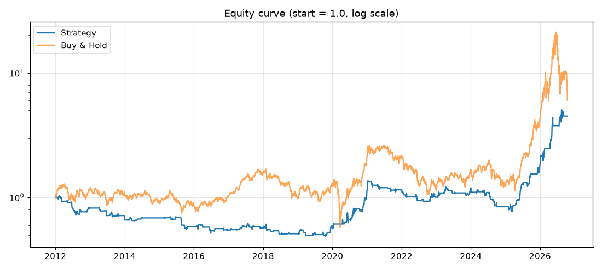

# 백테스트 결과: 익절없음_확인2일

- 실행 시각: 2026-10-15 20:10 (KST)
- 기간: 2012-01-02 ~ 2026-10-15
- 매매 종목: 122630.KS

## 핵심 성과

| 항목 | 이 전략 | 그냥 보유(Buy & Hold) |
|---|---|---|
| 누적 수익률(%) | 350.8 | 504.1 |
| 연평균 수익률 CAGR(%) | 10.7 | 12.9 |
| 최대 낙폭 MDD(%) | -53.0 | -71.6 |
| 거래 횟수 | 134 | - |
| 승률(%) | 53.0 | - |
| 거래당 평균 수익률(%) | 1.51 | - |
| 평균 보유일 | 11.0 | - |
| 보유 중이었던 날 비율(%) | 30.9 | 100 |



## 연도별 수익률(%)

| 연도 | 이 전략 | 그냥 보유 |
|---|---|---|
| 2012 | -17.8 | 15.6 |
| 2013 | -13.0 | -4.2 |
| 2014 | -4.2 | -17.2 |
| 2015 | -15.1 | -4.1 |
| 2016 | -5.9 | 15.1 |
| 2017 | 3.8 | 55.3 |
| 2018 | -10.1 | -35.2 |
| 2019 | 15.2 | 26.0 |
| 2020 | 89.7 | 63.3 |
| 2021 | 1.5 | 1.3 |
| 2022 | -11.5 | -46.4 |
| 2023 | 16.6 | 46.1 |
| 2024 | -28.1 | -25.6 |
| 2025 | 116.0 | 243.4 |
| 2026 | 147.7 | 41.9 |

## 최근 거래 30건

| 진입일 | 진입가 | 청산일 | 청산가 | 사유 | 수익률(%) | 보유일 |
|---|---|---|---|---|---|---|
| 2023-05-11 | 15792.89 | 2023-05-15 | 15367.31 | 신호 | -2.72 | 4 |
| 2023-06-13 | 17673.83 | 2023-06-29 | 16881.56 | 신호 | -4.51 | 16 |
| 2023-07-14 | 17363.68 | 2023-07-26 | 17466.26 | 신호 | 0.56 | 12 |
| 2023-11-07 | 15807.9 | 2023-11-14 | 15392.3 | 신호 | -2.66 | 7 |
| 2023-11-16 | 16113.05 | 2023-12-08 | 16156.92 | 신호 | 0.24 | 22 |
| 2023-12-19 | 16928.46 | 2024-01-05 | 17561.22 | 신호 | 3.71 | 17 |
| 2024-02-26 | 18259.12 | 2024-03-05 | 18510.74 | 신호 | 1.35 | 8 |
| 2024-03-11 | 18534.26 | 2024-03-19 | 18480.76 | 신호 | -0.32 | 8 |
| 2024-05-07 | 19564.78 | 2024-05-27 | 19145.42 | 신호 | -2.17 | 20 |
| 2024-05-29 | 19489.74 | 2024-05-31 | 18595.7 | 신호 | -4.62 | 2 |
| 2024-06-05 | 19009.5 | 2024-06-13 | 20069.96 | 신호 | 5.55 | 8 |
| 2024-07-09 | 22316.15 | 2024-07-25 | 19790.1 | 신호 | -11.35 | 16 |
| 2024-08-19 | 18969.48 | 2024-09-04 | 16776.61 | 신호 | -11.59 | 16 |
| 2024-09-23 | 16478.24 | 2024-10-04 | 16181.9 | 신호 | -1.83 | 11 |
| 2025-01-31 | 15092.54 | 2025-02-04 | 14582.7 | 신호 | -3.41 | 4 |
| 2025-02-14 | 15797.89 | 2025-03-04 | 15072.46 | 신호 | -4.62 | 18 |
| 2025-03-10 | 15432.71 | 2025-03-25 | 17211.39 | 신호 | 11.49 | 15 |
| 2025-04-17 | 14282.14 | 2025-05-07 | 15872.06 | 신호 | 11.1 | 20 |
| 2025-05-22 | 16348.17 | 2025-06-20 | 21634.18 | 신호 | 32.29 | 29 |
| 2025-06-30 | 23216.6 | 2025-07-10 | 24057.96 | 신호 | 3.59 | 10 |
| 2025-08-14 | 25617.8 | 2025-08-22 | 24427.78 | 신호 | -4.67 | 8 |
| 2025-09-02 | 24047.02 | 2025-09-05 | 25057.46 | 신호 | 4.17 | 3 |
| 2025-09-10 | 26133.06 | 2025-09-23 | 30844.57 | 신호 | 17.99 | 13 |
| 2025-12-02 | 40530.25 | 2026-01-09 | 56361.8 | 신호 | 39.02 | 38 |
| 2026-01-28 | 73616.79 | 2026-02-09 | 77761.1 | 신호 | 5.6 | 12 |
| 2026-02-12 | 81530.74 | 2026-02-19 | 88955.5 | 신호 | 9.07 | 7 |
| 2026-04-14 | 93856.9 | 2026-04-27 | 112648.65 | 신호 | 19.99 | 13 |
| 2026-04-30 | 119424.68 | 2026-05-18 | 151924.0 | 신호 | 27.18 | 18 |
| 2026-07-20 | 109919.93 | 2026-07-24 | 125167.38 | 신호 | 13.84 | 4 |
| 2026-08-04 | 96138.04 | 2026-09-02 | 100944.5 | 신호 | 4.97 | 29 |

## 가정과 한계 (꼭 읽어주세요)

- 신호는 외환 **일봉 종가** 기준이고, 매매는 **다음 코스피 거래일**에 체결된다고 가정했습니다(미래 데이터 엿보기 방지).
- 실제 알림은 15분마다 장중 가격으로 판단하므로 결과가 이 백테스트와 다를 수 있습니다.
- 전액 매수이며 소수점 수량도 허용합니다. 호가 단위, 미체결, 시초가 급변은 반영하지 않았습니다.
- 같은 날 손절과 익절이 모두 가능한 경우 손절이 먼저라고 보수적으로 가정했습니다.
- 과거 결과가 미래를 보장하지 않습니다. 조건을 여러 번 바꿔가며 가장 좋은 값만 고르면 과거에만 잘 맞는 설정(과최적화)이 되기 쉽습니다. 연도별 결과가 고르게 좋은지 함께 보세요.

## 이번에 사용한 설정

```toml
# ============================================================
#  백테스트 설정 파일
#  숫자, true/false, 따옴표 안의 글자만 바꾸세요. (# 으로 시작하는 줄은 설명입니다)
#  바꾼 뒤 저장(Commit)하고, GitHub의 Actions 탭에서 backtest 를 실행하면 됩니다.
# ============================================================

# 이번 실행의 이름 (결과 폴더 이름과 비교표에 표시됩니다. 조건을 바꿀 때마다 다르게 적어두세요)
label = "익절없음_확인2일"

# 백테스트 기간. end_date 를 비워두면 오늘까지입니다.
start_date = "2012-01-01"
end_date = ""

[market]
trade_ticker = "122630.KS"                         # 매매할 종목 (KODEX 레버리지)
fx_pairs = ["EURUSD=X", "GBPUSD=X", "AUDUSD=X"]    # 점수를 매길 외환

[signal]
ma_short = 5            # 이평선 (짧은 것)
ma_mid = 10             # 현재가와 비교하는 이평선
ma_long = 20            # 이평선 (긴 것)
buy_threshold = 2       # 합산 점수가 이 값 이상이면 '상승'
sell_threshold = -2     # 합산 점수가 이 값 이하이면 '하락'
confirm_days = 2        # 같은 신호가 며칠 연속 유지돼야 인정할지 (1 = 바로 인정, 2~3 으로 올리면 잦은 번복이 줄어듭니다)

[entry]
execution = "next_open"             # 체결 시점: "next_open"(다음 거래일 시가) 또는 "next_close"(다음 거래일 종가)
reentry_after_take_profit = false   # 익절 후 신호가 계속 '상승'이면 바로 다시 살지 (true/false)

[exit]
take_profit_pct = 0.0     # 수익률이 이 % 에 도달하면 전량 매도 (0 = 사용 안 함)
stop_loss_pct = 0.0       # 손실이 이 % 에 도달하면 전량 매도 (0 = 사용 안 함)
exit_on_neutral = true    # '중립' 신호가 되면 전량 매도
exit_on_down = true       # '하락' 신호가 되면 전량 매도

[cost]
fee_pct_per_side = 0.015       # 매수/매도 각각의 수수료 (%)
slippage_pct_per_side = 0.05   # 매수/매도 각각의 체결 오차 (%)
```
